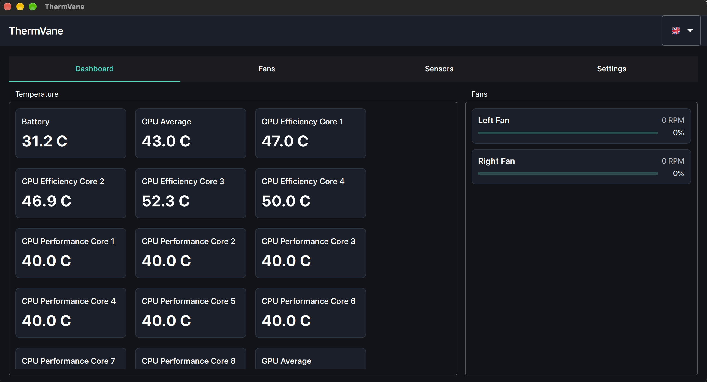
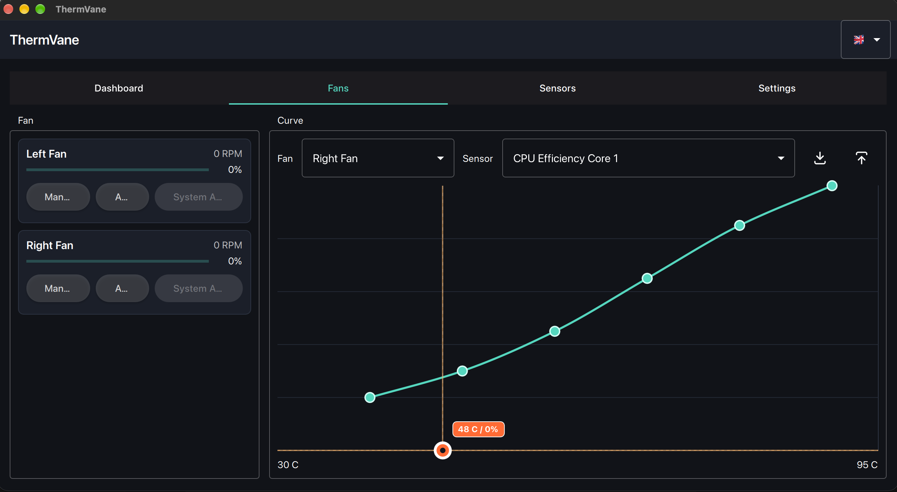

# OpenThermVane

<p align="center">
  <a href="https://github.com/AlexanderTonn/OpenThermVane/actions/workflows/installer-builds.yml">
    
  </a>
  
  
  
  
  
</p>

OpenThermVane is a Qt 6/QML desktop app for temperature monitoring and fan control.

## Features

- Apple Silicon SMC temperature sensors, CPU/GPU averages and MacBook fan RPM
- Per-fan sensor selection and temperature-based curves
- Manual, curve-based Auto and firmware System Auto control
- Live fan position on the curve, `.otvc` curve import/export and daily logging
- German/English UI, startup splash and automatic fan restore on exit/sleep

## Screenshots






## Installers

GitHub Actions builds the current installers for `main`:

- macOS: native `.dmg`
- Windows: Qt Installer Framework `.exe`
- Linux: Qt Installer Framework installer

See the [latest workflow run](https://github.com/AlexanderTonn/OpenThermVane/actions/workflows/installer-builds.yml).

## ⚠️ Unsigned builds

> [!WARNING]
> Release artifacts are currently **not code-signed or notarized**. Run them only when the download originates from a trusted repository or release.
>
> Do not disable Gatekeeper, Defender or other system-wide security controls globally.

### macOS

> [!CAUTION]
> macOS may block both the unsigned package and the installed app. The steps below explicitly approve this trusted copy.

1. Open the `.dmg` and run `ThermVane.pkg`.
2. If macOS blocks the package, Control-click it, choose **Open**, then confirm.
3. After installation, Control-click `ThermVane.app`, choose **Open**, then confirm **Open**.
4. If Gatekeeper still blocks it: **System Settings → Privacy & Security → Open Anyway**.

Do not disable Gatekeeper globally. The installer registers the privileged fan helper; macOS may ask once for administrator approval.

### Windows

> [!CAUTION]
> Windows SmartScreen may warn because the installer has no publisher signature.

1. Start the installer.
2. If SmartScreen appears, select **More info → Run anyway** after verifying the download source.
3. If Windows marks the file as blocked: right-click it, open **Properties**, select **Unblock**, then apply.

The installer may require administrator rights for fan-control components.

### Linux

Run the downloaded installer and grant administrator privileges when requested.

## Build from source

Requirements: Qt 6.5+ and CMake 3.24+.

```sh
cmake -S . -B build
cmake --build build
./build/ThermVane
```

For manual fan control on macOS during development:

```sh
./scripts/macos/build-and-install-fan-helper.sh
```

Remove the helper with:

```sh
./scripts/macos/uninstall-fan-helper.sh
```
